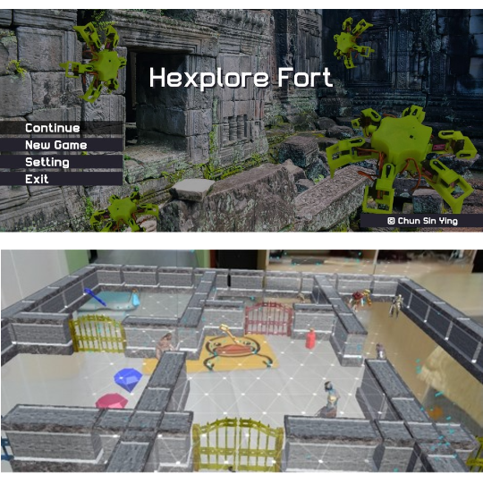
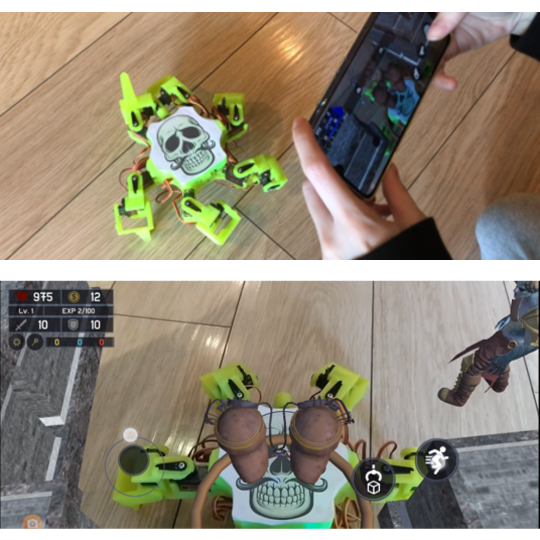

# Hexplore Fort

An augmented reality game integrated with a physical Hexapod robot, developed as my **Final Year Project**.

## Overview

Hexplore Fort combines mobile augmented reality gameplay with a physical Hexapod robot. The project explores how virtual gameplay and physical interactions can work together to create an interactive experience.

The game was developed with Unity and ARCore, with custom Android Bluetooth integration to communicate with and control the Hexapod.

## My Contributions

I worked on the game's design and development, including:

- **AR Gameplay:** Developed the augmented reality experience using Unity and ARCore, including plane detection and image recognition.
- **Android Bluetooth Integration:** Created a custom Unity Android plugin to enable Bluetooth communication between the mobile application and the Hexapod robot.
- **Robot Control:** Integrated the physical robot into the gameplay and implemented in-game controls, replacing the need for a separate Vorpal gamepad.
- **Game Development:** Designed and implemented the gameplay experience and the interaction between virtual and physical components.

## Technologies

- Unity 2019.1.14f1
- C#
- ARCore
- Android
- Java / Android Plugin
- Bluetooth
- Hexapod Robotics Arduino

## Recognition

Selected for exhibition at the **HKU 2nd Engineering InnoShow**.

## Screenshots

## Project Type

Final Year Project — The University of Hong Kong.

## Status

Completed.
